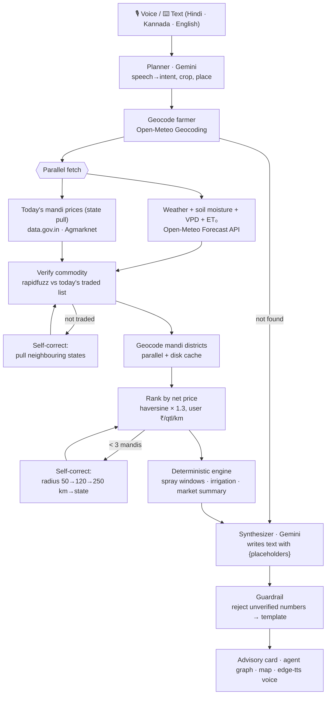

# 🌾 KisanSaathi — Agentic, voice-first farm advisor

**Voice-first farm advisory for Indian farmers, powered by Gnani Prisma and Timbre**

A farmer asks in Hindi, Kannada, or English, by voice or text: *"ನಾಳೆ ಟೊಮೇಟೊಗೆ ಔಷಧಿ ಸಿಂಪಡಿಸಬಹುದೇ?"*
(Should I spray my tomatoes tomorrow, and where should I sell?)
A LangGraph agent pulls **live** weather, soil moisture, evapotranspiration and **today's mandi prices**,
checks and corrects its own data gaps, computes the answer **in deterministic Python**, and replies in
Hindi, Kannada, or English with a neural voice. Every number shown or spoken is traceable to a live source.

## What makes it different
| | Typical farm chatbot | KisanSaathi |
|---|---|---|
| Numbers | LLM writes them (can hallucinate) | LLM writes **placeholders only**. Python fills every number, and a guardrail rejects any figure the LLM invents |
| Spraying | "Avoid spraying in rain" | Exact safe **time windows** from hourly rain probability, wind, temperature and **vapour-pressure deficit** |
| Irrigation | Generic tips | Root-zone **soil moisture** plus 3-day **rain vs FAO-56 ET₀** water balance gives irrigate now / soon / hold |
| Selling | One mandi price | Every mandi trading the crop today, ranked by **net ₹/quintal after the farmer's own transport cost** |
| Failures | Crashes or makes things up | Self-correction loops (neighbouring states, wider radius), disk fallback of the last real pull, honest warnings |

## Architecture


### Agent fallback layers

- Voice input tries Gnani Prisma first. If it fails, Gemini receives the original audio directly.
- If both voice recognizers fail, the user receives a clear request to retry by voice or type.
- Voice output tries Gnani Timbre first, then Edge-TTS, then gTTS.
- Gemini planning falls back to the rule-based planner, and advisory writing falls back to deterministic templates.
- Weather and mandi tools use memory and disk copies of the last real response when live APIs fail.

**Design principle: the LLM reasons and explains, Python calculates.** Gemini is used in only two nodes
(planner, synthesizer). Every node in between is deterministic and logged to the live **Agent Trace** in the UI.

### Components
| Layer | File | Notes |
|---|---|---|
| UI | `frontend/src/`, `server.py` | React dashboard and FastAPI streaming API; live node-by-node trace, charts and mandi map |
| Agent | `agent/graph.py`, `agent/nodes.py` | LangGraph `StateGraph` with conditional self-correction edges |
| Guardrail | `agent/guardrails.py` | placeholder rendering, ±1 / ±1 % number verification, deterministic HI/KN/EN templates |
| Tools | `tools/weather.py`, `tools/mandi.py`, `tools/geocode.py` | timeout + retry + memory TTL cache + disk fallback of last **live** response |
| Engine | `tools/engine.py` | spray windows, irrigation decision, net-price market ranking |
| Voice | `core/gnani.py`, `core/voice.py` | Gnani Prisma speech recognition and Timbre speech output, with Gemini/Edge-TTS/gTTS fallbacks |

### Live data sources (no mock data anywhere)
| Data | Source |
|---|---|
| Mandi prices (today) | data.gov.in resource `9ef84268-d588-465a-a308-a864a43d0070`, *Current Daily Price of Various Commodities from Various Markets (Mandi)*, Agmarknet / DMI |
| Hourly weather, VPD, FAO-56 ET₀, 4-layer soil moisture, soil temperature | Open-Meteo Forecast API |
| Geocoding (farmer + mandi districts) | Open-Meteo Geocoding API |
| Voice input | Gnani Prisma speech-to-text API with Hindi, Kannada, English, and auto detection (`GNANI_STT_MODEL`) |
| Voice output | Gnani Timbre text-to-speech API with Hindi, Kannada, and English voices (`GNANI_TTS_MODEL`) |

`.cache/` is created at runtime only from real API responses (git-ignored), so an outage serves the last
real pull **labelled with its fetch time**.

### Decision rules (deterministic)
- **Spray window:** daylight, rain probability ≤ 20 %, wind ≤ 15 km/h, 10–32 °C, VPD 0.3–1.6 kPa, no rain in the next 4 h, at least 2 consecutive hours.
- **Irrigation:** hold if 3-day rain ≥ 80 % of 3-day ET₀ (and ≥ 5 mm); irrigate now if root-zone moisture < 0.17 m³/m³; irrigate soon if < 0.27 and the 3-day balance is below −8 mm; otherwise no need.
- **Market:** FAQ-grade modal price (median across grades otherwise); road km = 1.3 × great-circle distance; net = modal − km × user's ₹/qtl/km.

## Run locally
```bash
pip install -r requirements.txt
cp .env.example .env   # optional: add your API keys for local development
uvicorn server:app --port 8000          # React UI + API at http://localhost:8000
```
The React frontend (`frontend/`, Vite + Tailwind + Recharts + Leaflet) is pre-built into `frontend/dist`
and served by FastAPI. To change the UI: `cd frontend && npm install && npm run dev` (proxies `/api` to :8000),
then `npm run build`.

Keys can be placed in environment variables or the git-ignored `.env` file:
`DATA_GOV_API_KEY` (data.gov.in → My Account → Generate Key), `GEMINI_API_KEY` (Google AI Studio), and
`GNANI_API_KEY` (Gnani API dashboard). Voice uses Gnani first, with Gemini audio understanding, Edge-TTS,
and gTTS fallbacks when configured providers are unavailable. Optional voice settings are `GNANI_STT_MODEL`, `GNANI_TTS_MODEL`,
`GNANI_HI_VOICE`, `GNANI_EN_VOICE`, and `GNANI_KN_VOICE`.
Without a Gemini key the app still runs: rule-based planner + deterministic templates.
A Streamlit version of the same agent is kept in `app.py` (`streamlit run app.py`).

### API
| Endpoint | Purpose |
|---|---|
| `GET /api/health` | which live sources are configured |
| `POST /api/warmup` | pre-fetch live weather + mandi data for a location |
| `POST /api/ask` | runs the agent; streams each graph node as Server-Sent Events, then the final result |

## Deploy (Render)
1. Keep `.env`, `.streamlit/secrets.toml`, and API keys out of the repository.
2. In Render, create a **New Blueprint Instance** from that repository. `render.yaml` uses the root `Dockerfile`, which builds the React frontend and Python API into one service.
3. Add `DATA_GOV_API_KEY`, `GEMINI_API_KEY`, and `GNANI_API_KEY` when Render prompts for them. The service checks `/api/health` after deployment.
4. Open the deployed URL, allow location access or enter a village and district, then use **Warm up live cache** before a demo. Free instances may sleep when idle.

## Limitations (honest)
- Soil moisture is model-derived (Open-Meteo), not an in-field sensor.
- Mandi distances use district HQ coordinates × road factor, not turn-by-turn routing.
- Agmarknet publishes only the current day; early in the morning fewer mandis may have reported.
